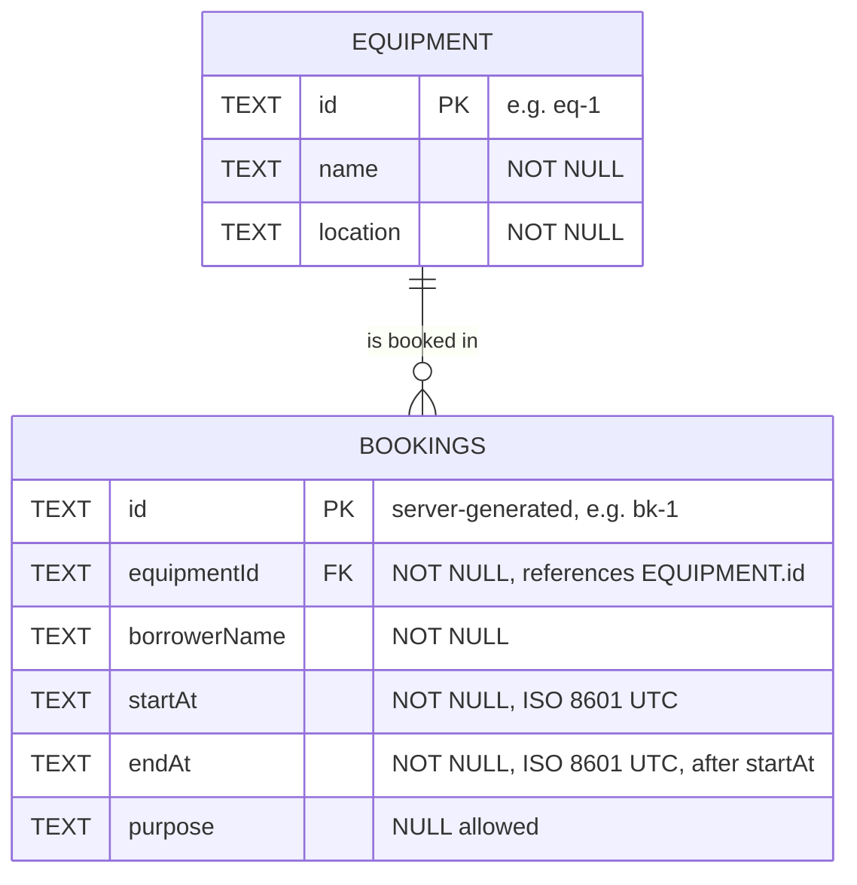

# Entity Relationship Diagram: Campus Equipment Booking API

This schema supports the endpoints and rules in [API_CONTRACT.md](API_CONTRACT.md).

## 1. Diagram



**Relationship:** one equipment can have many bookings (one-to-many). Each booking belongs to exactly one equipment.

## 2. Table: equipment

| Column | Type | Constraints | Maps to contract |
|---|---|---|---|
| id | TEXT | PRIMARY KEY | `id` in `GET /equipment` |
| name | TEXT | NOT NULL | `name` |
| location | TEXT | NOT NULL | `location` |

Equipment is seeded, not created through the API (contract section 8).

## 3. Table: bookings

| Column | Type | Constraints | Maps to contract |
|---|---|---|---|
| id | TEXT | PRIMARY KEY | `id`, generated by the server (section 2) |
| equipmentId | TEXT | NOT NULL, FOREIGN KEY to `equipment(id)` | `equipmentId`, must exist (section 5) |
| borrowerName | TEXT | NOT NULL | `borrowerName`, non-empty |
| startAt | TEXT | NOT NULL | `startAt`, ISO 8601 UTC |
| endAt | TEXT | NOT NULL, CHECK `startAt < endAt` | `endAt`, after `startAt` |
| purpose | TEXT | nullable | `purpose`, optional on create |

## 4. SQL

```sql
PRAGMA foreign_keys = ON;

CREATE TABLE IF NOT EXISTS equipment (
  id       TEXT PRIMARY KEY,
  name     TEXT NOT NULL,
  location TEXT NOT NULL
);

CREATE TABLE IF NOT EXISTS bookings (
  id           TEXT PRIMARY KEY,
  equipmentId  TEXT NOT NULL,
  borrowerName TEXT NOT NULL,
  startAt      TEXT NOT NULL,
  endAt        TEXT NOT NULL,
  purpose      TEXT,
  FOREIGN KEY (equipmentId) REFERENCES equipment(id),
  CHECK (startAt < endAt)
);

CREATE INDEX IF NOT EXISTS idx_bookings_equipment_time
  ON bookings (equipmentId, startAt, endAt);

INSERT OR IGNORE INTO equipment (id, name, location) VALUES
  ('eq-1', 'Projector A', 'Building 1'),
  ('eq-2', 'Camera B', 'Building 2');
```

## 5. Design Decisions

- **Times stored as TEXT in ISO 8601 UTC.** SQLite has no date type. If every value is normalized to the same format (for example with `new Date(value).toISOString()` before saving), string comparison matches time order. This lets the overlap query and the `CHECK` constraint work with plain `<` and `>`.
- **Foreign key from `bookings.equipmentId` to `equipment.id`.** The database rejects bookings for non-existent equipment, as a second safety net behind the API check that returns `404`. Foreign key enforcement must be switched on (`PRAGMA foreign_keys = ON`) in SQLite.
- **`CHECK (startAt < endAt)`.** A second safety net behind the API check that returns `400`.
- **Index on `(equipmentId, startAt, endAt)`.** Speeds up the overlap lookup, which always filters by equipment first.
- **`purpose` is nullable.** It is optional on create (contract section 5).
- **No UNIQUE constraint can prevent overlaps.** Overlap is a range rule, so the API must check it in a query before insert or update.

## 6. Overlap Query (Business Rule)

Used on `POST` and `PATCH`, with parameter binding only. `?` placeholders are bound by the driver, so request data never enters the SQL string.

```sql
SELECT id FROM bookings
WHERE equipmentId = ?
  AND startAt < ?   -- new endAt
  AND endAt   > ?   -- new startAt
  AND id != ?       -- PATCH only: exclude the booking being edited
LIMIT 1;
```

If a row is returned, the API responds `409`. Because the comparisons are strict (`<` and `>`), back-to-back bookings are allowed.

## 7. Cascade Behavior

No `ON DELETE CASCADE`. Equipment cannot be deleted through the API, so the default (reject deleting equipment that still has bookings) is enough. Deleting a booking does not affect equipment.
